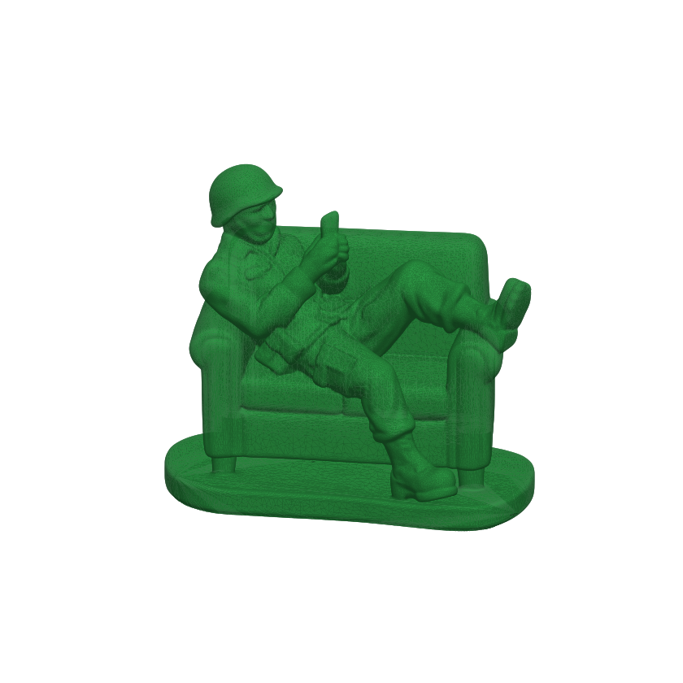

# Army Man on a Sofa

A printable green army-man figurine lounging on a sofa and looking at a phone. The mesh is reconstructed from a reference photo, then set on the bed as one watertight solid.



## Print files

| File | What it is |
| --- | --- |
| `army_man_sofa.stl` | Print this. Base down, longest side 140 mm. About 140 × 90 × 119 mm. |
| `army_man_sofa.3mf` | Same solid in 3MF. |
| `preview_front.png` / `preview_views.png` | Shaded views of the print mesh. |
| `army_man_raw.glb` / `army_man_raw.stl` | Mesh before scaling and bed alignment. |

Slice `army_man_sofa.stl` or `.3mf` at 10–15% infill. The solid volume is about 475 cm³, so a fully solid print wastes a lot of filament. Add supports under the raised boot and under the sofa. A 0.4 mm nozzle is enough for the helmet ridges, pockets, and boots. Eyes, separate fingers, and lace holes stay softer than the reference photo, and the unseen back is inferred from the single view.

## Regenerate

The checked-in mesh is the result. To build it again on an Apple Silicon Mac:

```bash
git clone --depth 1 https://github.com/Tencent-Hunyuan/Hunyuan3D-2.git .tools/Hunyuan3D-2
git -C .tools/Hunyuan3D-2 apply ../../patches/hunyuan3d-apple.patch

python3 -m venv .venv
.venv/bin/python -m pip install torch torchvision diffusers transformers accelerate \
  einops omegaconf tqdm trimesh pygltflib xatlas rembg onnxruntime \
  opencv-python-headless pyyaml safetensors huggingface_hub scikit-image \
  pymeshlab manifold3d matplotlib lxml

.venv/bin/python generate_from_reference.py
.venv/bin/python make_printable.py
```

`generate_from_reference.py` downloads the Hunyuan3D-2 shape weights (about 5 GB) and runs them on Metal. `make_printable.py` turns the largest horizontal span into 140 mm, puts the oval base on Z = 0, and writes the STL and 3MF. `.venv/` and `.tools/` stay local.

`build_model.py` is the earlier sphere-and-capsule stand-in. It writes `procedural_army_man.stl` and does not replace the photo mesh.

Shape generation uses [Hunyuan3D-2](https://github.com/Tencent-Hunyuan/Hunyuan3D-2) under the Tencent Hunyuan community license. The patch in `patches/hunyuan3d-apple.patch` only adapts that checkout for Apple Silicon.
